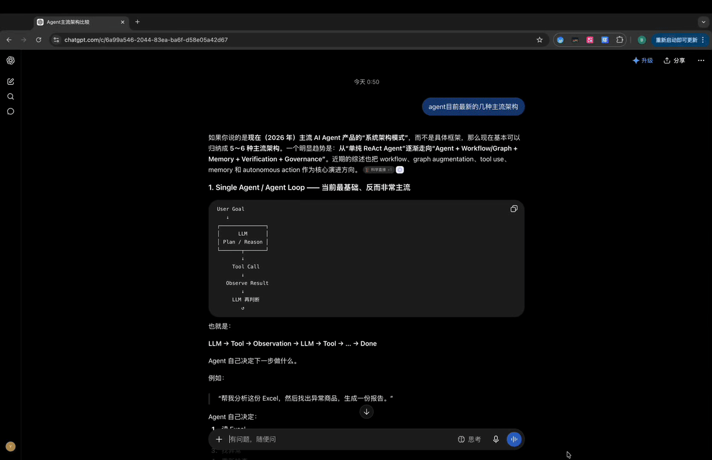

# ◎ CiteLens

**AI answers cite sources as tiny numbered links. CiteLens turns them into proof you can see.**

A Chrome extension that works natively on chatgpt.com: open any cited source *beside* the
answer, and let AI walk you — passage by passage, painted onto the live page — through **how
the source leads to the claim**.



▶ [高清视频版 (mp4)](docs/demo.mp4)

## The problem

A citation tells you a source *exists* — not which passage the claim came from, or how that
passage leads to the claim. Between "the AI said X" and "the source says Y" there is a
**derivation gap** that readers are left to close themselves: open the link, skim the whole
page, guess which paragraph the model meant, reconstruct the reasoning. That takes far too
much time to do for every claim.

CiteLens closes that gap for you, built around one metric: *time-to-verify* — how fast you go
from reading a claim to understanding exactly what it stands on.

## How it works

1. **◎ next to every citation.** In any ChatGPT answer, each cited link gets a ◎ button.
2. **The real page, split-screen.** Click it and the original source opens in Chrome's side
   panel — full layout, not a stripped-down reader view.
3. **One click: "Analyze".** Not a yes/no fact-check — a fast LLM call that closes the
   derivation gap:
   - **2–5 verbatim evidence quotes**, each tagged with a role that fits the article's genre
     (原理 / 推导 / 结论 / 数据 / 示例 / 条件 …) — one glance tells you which passage is the
     principle, which the data, which the conclusion
   - a short **reasoning chain** explaining how those passages add up to the claim — and if
     the source doesn't actually say what the answer claims, the reasoning says so plainly
4. **Whole-answer mode.** "◎ Verify answer" under a reply decomposes it into atomic
   claims, verifies each claim against its own citation in parallel, and flags the
   exceptions (⚠ overstated / ✗ contradicted / ⚠ not addressed) right on the answer —
   supported claims stay unmarked, so a flag always means something.
5. **Evidence painted onto the page.** Each quote is highlighted sentence-precisely in its
   role color, with a collapsible "why this passage matters" note under the paragraph.
   Role chips in the panel jump straight to their passage.

**Annotations can't hallucinate.** Every quote is validated as an exact substring of the
page's rendered text before anything is drawn — if the model paraphrases, the quote is
discarded, and the panel reports how many evidence items were actually located.

## Install

```
chrome://extensions → Developer mode → Load unpacked → select extension/
```

Then open any ChatGPT answer with citations and click a ◎. "Analyze" needs an Anthropic API
key (⚙ in the panel) — stored only in your browser, used only when you click. Model is
selectable: Sonnet 5 (default, ~$0.016/analysis), Opus 5 (deepest), or Haiku 4.5 (fastest). Chrome Web Store
listing: coming soon.

## Why this product

| Camp | Examples | What's missing |
| --- | --- | --- |
| RAG "chat with your docs" | NotebookLM, Kotaemon, RAGFlow | Great in-doc citations — but only inside their own chat, for your own files |
| AI chat with web citations | ChatGPT, Perplexity | Citations are links, not passages — verification is still manual |

CiteLens sits in the unclaimed middle: it doesn't replace your AI chat, it **overlays
verification onto the one you already use**. Zero migration cost is the distribution thesis.

## Quality: evals & metrics

The analysis pipeline is eval-gated. `eval/` holds a labeled dataset (zh/en claims ×
supported / overstated / contradicted / not_addressed sources) run through
[promptfoo](https://promptfoo.dev) against the **exact prompt and validation code the
extension ships** (`extension/core/verify.js`). Measured: JSON validity, verbatim-quote
rate, evidence anchor count, stance correctness (llm-rubric), latency and cost per model
— this is how the default model (Sonnet 5 over Haiku 4.5) is chosen with data rather
than vibes. Deterministic core logic runs as unit tests in CI on every push; the model
eval runs on demand. In the product itself, the north-star metric is instrumented
locally: the panel shows analyses count, average latency, and evidence locate rate,
stored only in `chrome.storage.local`. Every real analysis can be captured as a new
eval case with one click (⤓). Details: [eval/README.md](eval/README.md).

## Architecture decisions

- **Verbatim-or-drop.** Model-returned quotes must be exact substrings of the page's
  rendered text or they are discarded. Annotations can point at the wrong emphasis,
  never at text that isn't there.
- **Independent verifier.** The model that wrote the answer never grades itself: a
  ChatGPT answer is analyzed by a Claude model. A neutral cross-model overlay is the
  reason this exists as an extension rather than a feature of any one chatbot.
- **No verdict grades.** An earlier version shipped ✅/⚠️/❌ verdicts and we removed
  them: with frontier models most claims check out, so the grade carried little
  information while inviting "LLM judges LLM" circularity. The product is the
  derivation, not the judgment. (Shipped as exception-only flags: a
  supported claim shows nothing; overstated / contradicted / not-addressed claims get a
  flag — signal only where the information is.)
- **Deterministic control flow, bounded agency.** The core pipeline is a single LLM
  call orchestrated by code — no agent framework, because the flow is fully
  specifiable. Agentic control is reserved for the one step that needs it (planned:
  finding sources for uncited claims), with a fixed tool set and call budget.
- **Evaluated and rejected:** Chrome's built-in Gemini Nano as a zero-key local tier
  (its Prompt API text output doesn't support Chinese — our primary content — and the
  BYOK funnel doesn't exist for this product's audience); vector DB / RAG stack
  (page-level excerpting suffices); LangGraph-style orchestration (see above).

## Roadmap

- ~~Whole-answer overview~~ — shipped: "◎ Verify answer" decomposes an answer into
  atomic claims (VeriScore-style), verifies each against its citation in parallel
  (bounded: concurrency 2, 6-call budget), and paints exception flags back onto the
  answer itself
- Select any text in the answer → verify it, beyond citation granularity
- claude.ai adapter (the ChatGPT adapter is ~50 lines; selectors are config)
- Exportable verification reports; multi-model "citation diff"

## Stack

Chrome MV3, zero build step · Side Panel + declarativeNetRequest + CSS Custom Highlight API ·
Claude Sonnet 5 for analysis (Opus 5 / Haiku 4.5 selectable) · Mozilla Readability for extraction fallback

## Privacy

No backend, no data collection. Your API key lives in `chrome.storage.local`; page text goes
only to the Anthropic API, only when you click Analyze. Full policy: [PRIVACY.md](PRIVACY.md)
